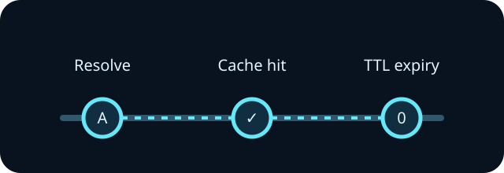

<div align="center">


<p><strong>A local, interactive DNS cache model with a controllable clock.</strong></p>
   
<br/>
</div>

## 🧭 Overview
DNS Cache Simulator models a small resolver cache without sending network queries. Add positive or negative records, advance virtual time, and observe TTL expiry and least-recently-used eviction.

## ✨ Features
- ⏱️ Advance a virtual clock to expire records deterministically.
- 🧊 Inspect cache hits, misses, and remaining TTL.
- 🚫 Model negative (NXDOMAIN) caching.
- ♻️ Observe LRU eviction at a fixed capacity.
- 🔒 Keep all simulation data in the browser.

## 🎬 Demo
Start the local app. Two sample records are loaded automatically; look them up, advance time, or add your own hostname and TTL.

## 🚀 Quick Start
Requires Node.js 20 or newer.

```bash
npm start
```

Open http://127.0.0.1:4174. Run checks with `npm test`.

## 🧰 Tech Stack
- 🟢 Node.js built-in HTTP server
- 🌐 HTML, CSS, and JavaScript modules
- 🧪 Node.js built-in test runner

## 🗂️ Folder Structure
```text
public/       Simulator interface and cache model
test/         Cache behavior tests
assets/       Original SVG artwork
.github/      CI workflow
server.js     Dependency-free static server
```

## 🛣️ Roadmap
- [ ] Add configurable cache capacity.
- [ ] Compare FIFO and LRU eviction.
- [ ] Export simulation traces as JSON.

## 🤝 Contributing
Contributions are welcome. Keep time deterministic in tests and make the difference between a simulated cache and real DNS resolution explicit.

## 📄 License
MIT. See [LICENSE](./LICENSE).

<div align="center"></div>
